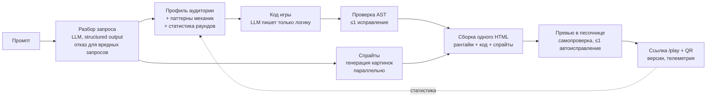

# Демо и презентация

Материал для спикера и дизайнера презентации. Все цифры ниже получены замерами на проекте (`tools/bench.ts`, `tools/redteam.ts`, `tools/sandbox-escape.ts`, `tools/e2e-ui.ts`).

## Одной фразой

Пишете «замути змейку для бабушки» — через ~50 секунд получаете играбельную мобильную мини-игру по ссылке: крупные кнопки, спокойные цвета, нарисованные ИИ персонажи, работает в WebView без сервера.

## Сценарий на 3–5 минут

| Время | Что показываем | Что говорим |
|---|---|---|
| 0:00–0:30 | Слайд с задачей | Суперапкам нужны мини-игры под разные аудитории, делать каждую вручную долго. Мы генерируем их по одной фразе. |
| 0:30–0:45 | Главная, вводим промпт из зала или «Лови падающие фрукты корзинкой, для ребёнка 7 лет» | Пока идёт генерация (~50 с), видно этапы: разбор запроса → код → проверка → графика → публикация. |
| 0:45–1:30 | Пока генерируется — слайд архитектуры | Модель пишет только логику игры; всё остальное (экран, управление, звук, рекорды) — наш проверенный рантайм. Поэтому игры стабильно запускаются. |
| 1:30–2:15 | Готовая игра в рамке телефона, жюри сканирует QR | Играть можно сразу на своём телефоне. Отметить: «Запуск проверен» — превью само проверило игру. |
| 2:15–3:00 | Чип «Сделай кнопки больше» или своя правка | Итеративная доработка: v2 за ~40 с, история версий, старая ссылка продолжает работать. |
| 3:00–3:40 | Галерея и страница «Статистика» | Адаптация под аудиторию на основе исследований и учёт статистики сыгранных раундов в новых играх. |
| 3:40–4:20 | Слайд «Безопасность» | Red team 10/10, песочница 25/25 — даже скомпрометированный код игры не выходит наружу. |
| 4:20–5:00 | Цифры и итог | 10/10 игр запускаются, медиана ~50 с, все 7 бонусных пунктов кейса. |

**Запасной вариант:** заранее сгенерированная галерея (несколько игр разных жанров и аудиторий) и видео полного прохода. Если сеть или LLM недоступны, показываем их и прямо говорим, что это запись.

## Архитектура (для слайда)

## Цифры

| Что | Результат |
|---|---|
| Игр из 10 разных промптов, запустившихся без ошибок | **10/10** (во всех прогонах) |
| Время генерации, медиана | **49 с** со спрайтами (Sol fast); 76 с без fast-режима |
| Правка текстом | ~40–55 с, игра после правки запускается |
| Спрайты, нарисованные ИИ | 17/17 запрошенных, ~20 КБ каждый, встроены в HTML |
| Жанры в бенчмарке | аркада, кликер, три в ряд, викторина, раннер, головоломка |
| Red team prompt-инъекций | **10/10** без пробития |
| Тест побега из песочницы | **25/25** проверок |

## Покрытие требований кейса

| Пункт | Как сделано |
|---|---|
| Текстовый промпт | Свободный текст, в т.ч. разговорный («замути») |
| Генерация через LLM, не шаблон | LLM пишет правила, сущности, отрисовку и условия исхода; фиксирован только рантайм |
| Playable: старт → геймплей → победа/поражение | Рантайм гарантирует экраны и рестарт; проверка требует `kit.win`/`kit.lose` |
| Self-contained, WebView | Один HTML без внешних ресурсов, работает без сети после загрузки |
| Адаптация под аудиторию | Профили с первоисточниками: размеры целей, шрифты, скорость, палитра |
| Учёт аналитики | Паттерны механик из публичных кейсов суперапок + статистика своих раундов |
| Итеративная доработка | Правка текстом, история версий, любую версию можно открыть по ссылке `/play/:id?v=N` |
| Генерация ассетов | Спрайты ИИ + синтез звуков WebAudio |
| Адаптивность | Touch, свайпы, letterbox под любой экран, пауза при сворачивании |
| Галерея и шаринг | Галерея с обложками, ссылка и QR |
| Вариативность жанров | 6 жанров в бенчмарке |

## Вероятные вопросы жюри

- **«Это же шаблоны?»** Нет. Шаблон — это готовая змейка, где меняется цвет. У нас модель пишет логику с нуля: «гравитация меняется каждые 5 секунд» или «собирай только чётные числа» — это новые правила, их нельзя получить сменой параметров. Фиксирован только рантайм (экран, ввод, звук) — как движок у игровой студии.
- **«Что если игра сломается?»** Код проверяется до публикации (одна попытка исправления), затем превью запускает игру и при ошибке выполнения отправляет её модели на исправление. Статус «Запуск проверен» — честная проверка запуска, не гарантия идеального геймплея.
- **«А если попросить что-то вредное / взломать?»** Покажите `docs/security.md`: вредные запросы получают вежливый отказ, технические вставки (кража cookie, eval, редирект) выбрасываются, а даже полностью вредоносный код блокируется песочницей браузера.
- **«Откуда статистика, у вас же нет данных Билайна?»** Профили аудиторий собраны из исследований (WCAG, NN/g, научные работы по пожилым и детям), паттерны механик — из публичных кейсов суперапок (Билайн, Т-Банк, Сбер, Альфа) с источниками. Свои игры собирают телеметрию, и сегменты с достаточным числом сессий влияют на новые генерации. Демонстрационные числа мы так и называем.
- **«Сколько стоит генерация?»** Один промпт — два запроса к текстовой модели (разбор и код) плюс до трёх картинок. Модель задаётся строкой в конфиге: можно подставить любую OpenAI-совместимую, в том числе развёрнутую у Билайна.
- **«Как встроить в приложение?»** Каждая игра — статичная страница `/play/:id`. Её открывают в WebView как обычную ссылку; серверу во время игры ничего не нужно.
