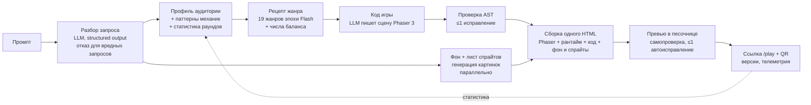

# Демо и презентация

Материал для спикера и дизайнера презентации. Все цифры ниже получены замерами на проекте (`tools/bench.ts`, `tools/redteam.ts`, `tools/sandbox-escape.ts`, `tools/e2e-ui.ts`).

## Одной фразой

Пишете «замути змейку для бабушки» — примерно через две минуты получаете играбельную мобильную мини-игру по ссылке: нарисованный ИИ мир и персонажи, уровни, бонусы, музыка, крупные кнопки для пожилых. Работает в WebView без сервера.

## Сценарий на 3–5 минут

| Время | Что показываем | Что говорим |
|---|---|---|
| 0:00–0:30 | Слайд с задачей | Суперапкам нужны мини-игры под разные аудитории, делать каждую вручную долго. Мы генерируем их по одной фразе. |
| 0:30–0:45 | Главная, вводим промпт из зала или «Лови падающие фрукты корзинкой, для ребёнка 7 лет» | Пока идёт генерация (~2 мин), видно этапы с таймингами, спецификацию, палитру и спрайты будущей игры. Модель сама выбирает жанровый рецепт и числа баланса. |
| 0:45–1:30 | Пока генерируется — слайд архитектуры | Модель пишет сцену на Phaser 3 (физика, анимации, камера) по рецепту жанра, ИИ параллельно рисует фон и все спрайты одним листом в едином стиле. Экраны, звук, музыка, эффекты, честные хитбоксы, жизни и разминка — наш рантайм. Поэтому игры и красивые, и стабильно запускаются. |
| 1:30–2:15 | Готовая игра в рамке телефона, жюри сканирует QR | Играть можно сразу на своём телефоне. Отметить: «Запуск проверен» — превью само проверило игру. |
| 2:15–3:00 | Чип «Сделай кнопки больше» или своя правка | Итеративная доработка: v2 примерно за 1,5 мин (готовые картинки переиспользуются), история версий, старая ссылка продолжает работать. Вкладка «Код» показывает, что написала модель. |
| 3:00–3:40 | Галерея и страница «Статистика» | Адаптация под аудиторию на основе исследований и учёт статистики сыгранных раундов в новых играх. |
| 3:40–4:20 | Слайд «Безопасность» | Red team 10/10, песочница 25/25 — даже скомпрометированный код игры не выходит наружу. |
| 4:20–5:00 | Цифры и итог | 15/15 игр демо-галереи запускаются, медиана ~2 мин, 19 жанров, все 7 бонусных пунктов кейса. |

**Запасной вариант:** заранее сгенерированная галерея (15 игр разных жанров и аудиторий) и ускоренные скринкасты полного прохода (их требуют организаторы). Если сеть или LLM недоступны, показываем их и прямо говорим, что это запись.

## Архитектура (для слайда)

## Цифры

| Что | Результат |
|---|---|
| Игры демо-галереи (15 промптов), запустившиеся без ошибок | **15/15**, бенчмарк из 10 промптов — 10/10 |
| Время генерации, медиана | **113 с** на 15 промптах демо-галереи (GPT 6.1 Sol fast, Phaser, фон и лист спрайтов); прежний мини-движок — 49 с, но игры заметно беднее |
| Правка текстом | ~1,5 мин, игра после правки запускается (проверено сквозным тестом интерфейса) |
| Картинки ИИ | Фон 720×1280 и лист из 3–6 спрайтов в едином стиле на игру; в демо-галерее арт полный у 15/15 |
| Жанровые рецепты | 19: ловля, прыгун, шутер, тир, раннер, арканоид, башня, катапульта, tower defense, змейка, три в ряд, мемори, викторина, кликер, слайсер, поиск предметов, раскраска, найди отличия, гонка |
| Red team prompt-инъекций | **10/10** без пробития |
| Тест побега из песочницы | **25/25** проверок, отдельно для обоих движков |
| Автоподбор сложности | После проверки запуска превью за 0,2–5 с проигрывает игру ботами на виртуальном времени (хороший, небрежный, наугад, бездействие) и подбирает скорость, жизни и время так, чтобы небрежный выигрывал около половины раундов (дети и пожилые — три четверти). Небрежного делает рантайм одинаково для всех игр; по независимому плейтесту он совпадает с ботом-человеком (тир 68% против 63–88%, арканоид 39% против 37,5%). Если игру не удаётся сбалансировать скоростью, страница честно показывает «Баланс не подобран» |
| Забег вместо одного раунда | Победа на уровне ведёт на следующий, сложнее (цель, скорость, новые объекты, босс каждый 5-й), счёт копится, рекорд — лучший счёт и уровень. Для игр-«погонь за рекордом» (блоки, флаппи, раннер) — бесконечный режим, как Block Blast |
| Разный вид игр | HUD в одном из четырёх стилей (фишки, крупные цифры по углам, панель из материала темы, шкала из иконок), баннеры в цветах игры |
| Сравнение моделей для кода | Opus 5.5 fast: те же 4/4 игры, но медиана 267 с против 98 с у Sol fast без видимой разницы в качестве — оставили Sol |

## Покрытие требований кейса

| Пункт | Как сделано |
|---|---|
| Текстовый промпт | Свободный текст, в т.ч. разговорный («замути») |
| Генерация через LLM, не шаблон | LLM пишет сцену Phaser: правила, сущности, физику, уровни и условия исхода; фиксированы только движок и рантайм |
| Playable: старт → геймплей → победа/поражение | Рантайм гарантирует экраны и рестарт; проверка требует `GG.win`/`GG.lose`; раунд без таймера не может длиться вечно |
| Self-contained, WebView | Один HTML без внешних ресурсов, работает без сети после загрузки |
| Адаптация под аудиторию | Профили с первоисточниками: размеры целей, шрифты, скорость, палитра |
| Учёт аналитики | Паттерны механик из публичных кейсов суперапок + статистика своих раундов |
| Итеративная доработка | Правка текстом, история версий, любую версию можно открыть по ссылке `/play/:id?v=N` |
| Генерация ассетов | Фон и лист спрайтов ИИ, восьмибитная фоновая музыка и звуки синтезируются WebAudio |
| Адаптивность | Touch, свайпы, letterbox под любой экран, пауза при сворачивании |
| Галерея и шаринг | Галерея с обложками, ссылка и QR |
| Вариативность жанров | 19 жанровых рецептов, модель выбирает рецепт сама; запросы вне рецептов генерируются с нуля |

## Вероятные вопросы жюри

- **«Это же шаблоны?»** Нет. Шаблон — это готовая змейка, где меняется цвет. У нас модель пишет логику с нуля: «гравитация меняется каждые 5 секунд» или «собирай только чётные числа» — это новые правила, их нельзя получить сменой параметров. Фиксированы только движок Phaser и наш рантайм (экраны, звук, эффекты) — как движок у игровой студии. Во вкладке «Код» видно, что модель написала.
- **«Что если игра сломается?»** Код проверяется до публикации (одна попытка исправления), затем превью запускает игру и при ошибке выполнения отправляет её модели на исправление. Статус «Запуск проверен» — честная проверка запуска, не гарантия идеального геймплея.
- **«А если попросить что-то вредное / взломать?»** Покажите `docs/security.md`: вредные запросы получают вежливый отказ, технические вставки (кража cookie, eval, редирект) выбрасываются, а даже полностью вредоносный код блокируется песочницей браузера.
- **«Откуда статистика, у вас же нет данных Билайна?»** Профили аудиторий собраны из исследований (WCAG, NN/g, научные работы по пожилым и детям), паттерны механик — из публичных кейсов суперапок (Билайн, Т-Банк, Сбер, Альфа) с источниками. Свои игры собирают телеметрию, и сегменты с достаточным числом сессий влияют на новые генерации. Демонстрационные числа мы так и называем.
- **«Как вы проверяете, что игра не слишком лёгкая и не слишком сложная?»** Модель пишет в каждой игре бота-игрока, а наш рантайм делает из него «небрежного» (задержка реакции, промахи, отвлечения) и за секунды проигрывает десятки раундов без отрисовки. По итогам подбираются скорость, жизни и время раунда — плашка «Сложность подобрана» на странице игры показывает результат.
- **«Почему игры хорошие, если их пишет ИИ?»** Модель получает рецепт жанра с числами прогрессии и типичными ошибками генерации (собраны из постмортемов и исследований game feel), а честность обеспечивает рантайм: хитбоксы по видимой части картинки, разминка, прощение первой ошибки, жизни. Игры проходили многораундовый плейтест ботами с профилями «хороший», «небрежный», «наугад».
- **«Сколько стоит генерация?»** Один промпт — два запроса к текстовой модели (разбор и код) плюс две картинки (фон и лист спрайтов). Модель задаётся строкой в конфиге: можно подставить любую OpenAI-совместимую, в том числе развёрнутую у Билайна.
- **«Как встроить в приложение?»** Каждая игра — статичная страница `/play/:id`. Её открывают в WebView как обычную ссылку; серверу во время игры ничего не нужно.
